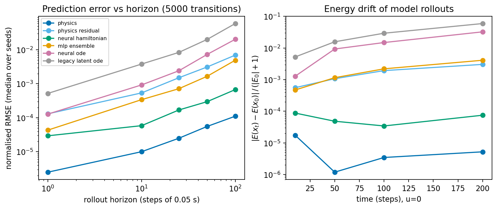
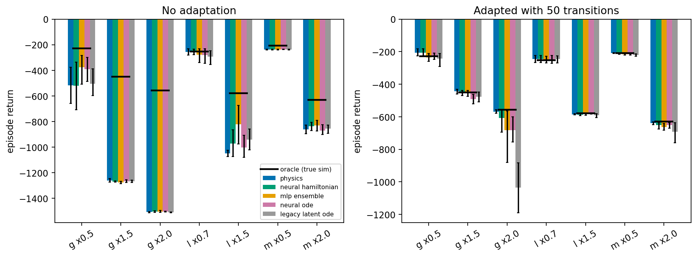
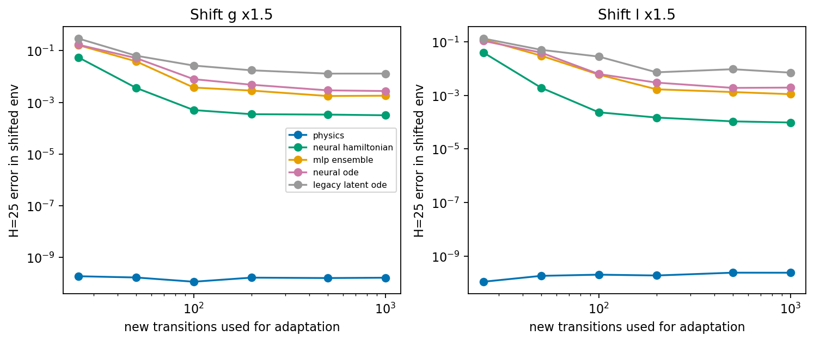

# Physics-Informed World Models for Learning Dynamical Systems


This repository has two parts.

* **Part I, orbit prediction.** Physics informed world models for a two body orbit (report: [`report.pdf`](./report.pdf); read it with the corrections in [`docs/ERRATA_PART_I.md`](docs/ERRATA_PART_I.md)).
* **Part II, control extension.** The same question asked for control: do physics structured world models help a model based agent learn a pendulum swing up with less data, and keep working when gravity, length or mass change? (report: [`report_control.pdf`](./report_control.pdf), code in `src/control/`).

Part I is the original work described next.

The project looks at how learned models fail when they are rolled out far beyond their training data on a continuous dynamical system (a two body orbit), and tests a **latent neural ODE** with an energy-variance penalty as a way to keep long rollouts on a physically sensible orbit.

📄 **Part I paper:** [`report.pdf`](./report.pdf) (see [`docs/ERRATA_PART_I.md`](docs/ERRATA_PART_I.md): some statements in it do not match the code)  
📄 **Part II paper (control extension):** [`report_control.pdf`](./report_control.pdf)

---

## 🔬 Overview & Key Findings

Predicting complex physical environments is a cornerstone of scientific computing and Model-Based Reinforcement Learning (MBRL). Traditional numerical solvers (like Runge-Kutta) are accurate but computationally expensive, driving the need for Machine Learning surrogates.

However, purely data-driven networks have no built-in physical priors such as energy conservation, so their **rollout errors compound**. Physics-Informed Neural Networks (PINNs) add physics to the loss, but as functions of time they can still drift over long horizons.

**What this part shows (one system, one run per model; see the re-run below):**
1. **Autoregressive MLP:** a one-step MLP drifts once its own predictions are fed back in.
2. **PINN:** a time-to-state PINN drifts over long horizons; in the seeded re-run it did not fit even its training window.
3. **PIWM:** a latent neural ODE (dopri5) with an energy-variance penalty, trained on the first 400 steps, was rolled out to 10,000 steps (25× its training window). In the seeded re-run it stays within about 0.24 of the true orbit's path for the whole rollout, but its period is slightly off, so its position drifts from about step 580. Energy conservation was not measured numerically.
---

## 📊 Experimental Results

The trajectory is 10,000 RK4 steps (dt = 0.01). The three models do **not** see the same data in the current scripts:

| Model | Training data (as in the code) |
|---|---|
| Naive MLP (`src/train_naive.py`) | one-step pairs from the **whole** trajectory (all 10,000 steps) |
| PINN (`src/train_pinn.py`) | the first **2,000** steps |
| PIWM (`src/train_world_model.py`) | the first **400** steps (4%); then rolled out to step 10,000 (25× the training window) |

Each model is then rolled out freely from the initial state to step 10,000. Because the MLP sees the whole trajectory, it is not a like-for-like baseline.

### 1. The Ground Truth (RK4 Integrator)
The target system is an elliptical 2-body orbit governed by Newtonian gravity, generated using a custom RK4 numerical solver.
See [assets](assets) for the orbit plot and other generated figures.

### 2. Baseline 1: Naive Autoregressive MLP
Trained purely on data, the naive model's rollout compounds its own one-step errors. In the original (unseeded) run shown in `assets/` it spiralled away from the orbit; in the seeded re-run below it stayed close to the orbit's path but drifted in phase.
See [assets](assets) for the baseline visualization.

### 3. Baseline 2: Standard Physics-Informed Neural Network (PINN)
The PINN adds the gravitational equations to its loss via automatic differentiation. As a direct map from time to position it did not close the periodic orbit over the 10,000-step horizon in the original run; spectral bias is a likely cause, but it was not tested separately.
See [assets](assets) for the PINN visualization.

### 4. Physics-Informed World Model (PIWM)
The latent neural ODE world model combines adaptive ODE integration with an energy-variance penalty (weight 0.1, a soft penalty, not a hard constraint). Its rollout stays on a bounded, closed orbit close to the true one, but its orbital period is slightly off, so its position drifts away from the ground truth over time (see the re-run below).
See [assets](assets) for the world model visualization.

---

### 5. Seeded re-run (figures used on the portfolio)

`analysis/make_site_figures.py` re-runs the three Part I training scripts exactly as written, with seed 0 and 2 CPU threads (about 80 s on an M2), and writes `results/site_figures.json` and `figures/site_orbit_error.png`. It reports two errors along the rollout: position error, and distance from the true orbit's path (is the model on the right orbit, whatever its timing).

| Model | Position error first above 0.5 | Max distance from the true orbit's path |
|---|---|---|
| PIWM (trained on steps 0-400) | step 580 | 0.24 (bounded for all 10,000 steps) |
| Naive MLP (trained on all 10,000 steps) | step 1,380 | 0.017 |
| PINN (trained on steps 0-2,000) | step 0 (did not fit) | 1.03 |

So in this run the PIWM keeps a stable orbit for 25× its training window but does not track the position, and the MLP, which saw far more data, stays closer to the true path. One seed per model; results from other seeds may differ. The same script also redraws the Part II learning curves from `results/phase_d_pendulum.json` (`figures/site_learning_curves.png`).

---

## ⚙️ Repository Structure

A clean, modular architecture built for reproducibility and easy expansion into MBRL environments.

```text
physics-informed-world-models/
├── assets/                 # Versioned figure assets
│   ├── naive_mlp_failure.png
│   ├── orbit_plot.png
│   ├── pinn_prediction.png
│   └── world_model_success.png
├── data/                   # Data generation scripts and local artifacts
│   ├── generate_orbit.py   # RK4 ground-truth simulator
│   └── trajectories/       # Generated .npy outputs (gitignored)
│       ├── naive_mlp_prediction.npy
│       └── orbit_data.npy
├── src/                    # Core machine learning architecture
│   ├── dynamics.py         # True mathematical derivatives
│   ├── models.py           # PIWM Autoencoder & Neural ODE definitions
│   ├── pinns.py            # PINN architecture and physical loss functions
│   ├── train_naive.py      # Baseline MLP training loop
│   ├── train_pinn.py       # PINN multi-objective training loop
│   ├── train_world_model.py# PIWM training loop (Gradient Clipping, Dopri5)
│   └── utils.py            # Evaluation and visualization tools
├── src/control/            # PART II: control extension
│   ├── envs/               # pendulum, cartpole, acrobot (batched RK4) + Gymnasium bridge
│   ├── models/             # MLP ensemble, neural ODE, structured physics, residual, neural Hamiltonian, legacy latent ODE
│   ├── planners/           # batched MPPI and CEM
│   ├── agents/             # model based control loop, SAC baseline
│   ├── adapt/              # system identification from a few transitions
│   └── eval/               # data, trainer, rollout metrics, bootstrap statistics
├── experiments/            # Part II run scripts (phase_c to phase_f, gate_b, run_all)
├── analysis/               # figure and LaTeX table generation from results/
├── results/                # raw result files (JSON) and summary_table.md
├── figures/                # Part II figures and demo GIF
├── demo/                   # GIF generation
├── docs/                   # design decisions, bug log, summary, report LaTeX source
├── tests/                  # Unit tests (orbit physics and control extension)
│   ├── test_dynamics.py
│   └── test_envs.py, test_planners.py, test_models.py, test_stats_seed_adapt.py
├── requirements.txt        # Python dependencies
├── LICENSE                 # MIT License
├── README.md               # Project documentation
├── report.pdf              # Part I research paper (orbit)
└── report_control.pdf      # Part II report (control extension)
```

## 🚀 Getting Started

### 1. Environment Setup
Clone the repository and install the dependencies within a virtual environment:

Bash

```bash
git clone https://github.com/Optimus2007/physics-informed-world-models.git
cd physics-informed-world-models
python3 -m venv venv
source venv/bin/activate  # On Windows use: venv\Scripts\activate
pip install -r requirements.txt
```

### 2. Run the Pipeline
Execute the modules in the following order to replicate the research findings:

**Step A: Generate Ground-Truth Data**

Bash

```bash
python data/generate_orbit.py
```

**Step B: Train the Naive Baseline**

Bash

```bash
python src/train_naive.py
```

**Step C: Train the PINN**

Bash

```bash
python src/train_pinn.py
```

**Step D: Train the Physics-Informed World Model**

Bash

```bash
python src/train_world_model.py
```

### 3. Run Unit Tests
To verify the mathematical integrity of the underlying physics engine:

Bash

```bash
python -m unittest tests/test_dynamics.py
```

## 🎛️ Part II: Control Extension

Part I predicts. Part II asks whether physics structure also helps an agent that has to act. The orbit model had no control input and its physics entered only as a soft energy penalty, so it was never Hamiltonian and its results do not carry over to control. Part II therefore builds new action conditioned models and keeps the old one only as a baseline called `legacy_latent_ode`. The full write up, with every figure and reference, is [`report_control.pdf`](./report_control.pdf).

**Setup.** Pendulum swing up in a batched RK4 simulator (cross checked against Gymnasium Pendulum v1), MPPI planning inside the learned model, SAC as a model free reference, five seeds, simulation only, noise free.

**Findings (all numbers are in `results/`)**
* With 500 random transitions every model, even the legacy one, solves the swing up, so sample efficiency does not separate them there. With only 50 transitions, physics, physics plus residual and a neural Hamiltonian solved 5 of 5 seeds, the MLP ensemble 3, the neural ODE 4 and the legacy model 1. This is suggestive, not conclusive.
* Prediction after 100 steps (median error): physics 1.1e-4, neural Hamiltonian 6.7e-4, MLP ensemble 4.9e-3, neural ODE 2.0e-2. The Hamiltonian's energy drift stays flat.
* After a gravity, length or mass shift, 50 new transitions bring every model close to an oracle planner's return. The physics model's prediction error falls to about 1e-10, and no black box matched that even with 1000 transitions.
* With unmodelled friction and a hidden motor limit the physics model's error is 0.28. A learned residual brings it to 0.006, which equals a plain MLP, and control return barely changes.





**Limits.** Learning experiments use the pendulum only (cart pole and acrobot simulators exist and are tested, with no learned models on them). The structured model has exactly the right equations, which is the best case for physics. Only the combinations 3g/2l and 3/(ml^2) are identifiable, not mass, length and gravity separately. A demo animation is at [`figures/demo_shifted_gravity.gif`](figures/demo_shifted_gravity.gif).

**Reproduce Part II**
```bash
make test            # orbit test plus 38 control tests
make report_figs     # figures and results/summary_table.md from results/
make report          # tables and the report PDF (needs tectonic)
make phase_c phase_d phase_d_lowdata phase_e phase_f   # recompute the raw results (hours on a laptop CPU)
make demo
```
The Phase D models are saved to `results/models/` (not tracked) and Phase E needs them, so run `make phase_d` before `make phase_e`.

**Credits and licences.** Gymnasium (Pendulum v1, cross check), `pytorch_mppi` (planner cross check), the structure of CleanRL's SAC (MIT), and the Symplectic ODE Net paper (Zhong et al., ICLR 2020), which I re implemented in my own style and did not copy. Full references are in the report.

## 🔮 Future Work
* Run the same pipeline on the cart pole and acrobot, with observation noise.
* Train the black boxes with multi step losses and test uncertainty driven choice of which transitions to collect.
* The original Dreamer style idea (a latent imagination engine with physical priors) is still open. Part II used state space models, not a learned latent space.

## 📄 License
This project uses the MIT license terms for research and educational use.

*Developed by Aditya Raj.*
