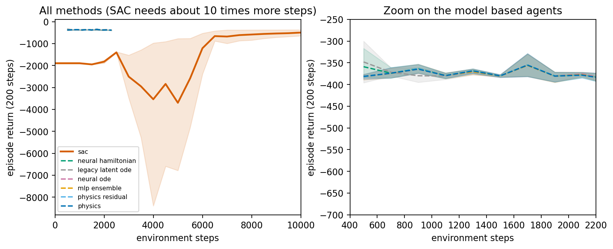
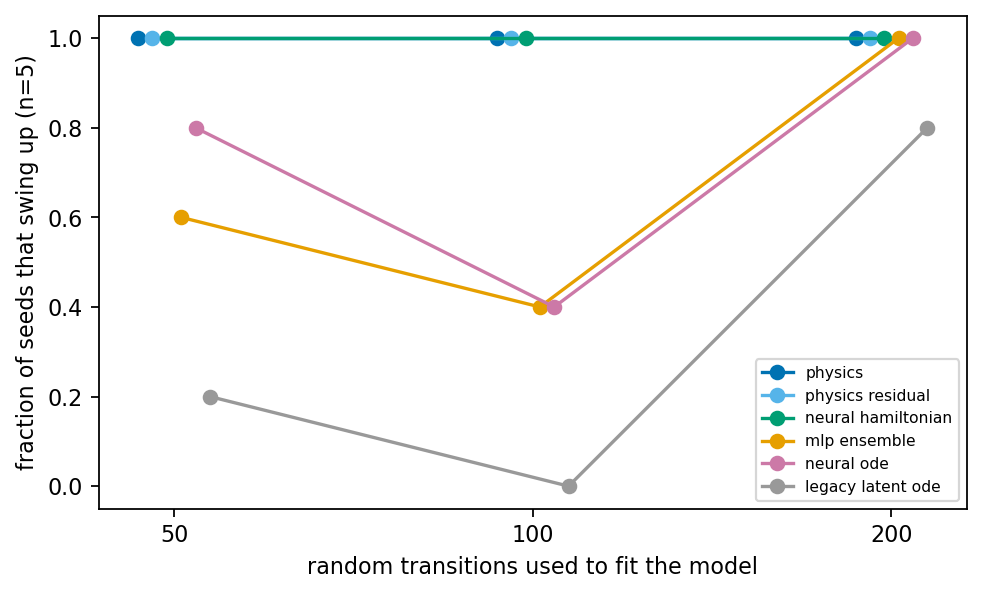
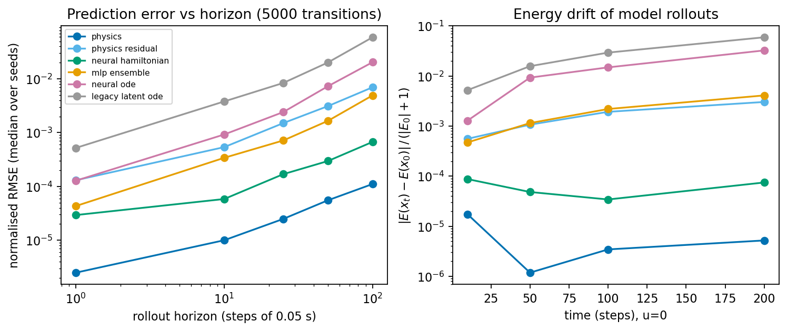
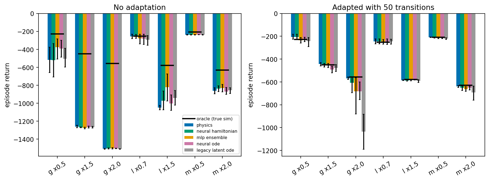
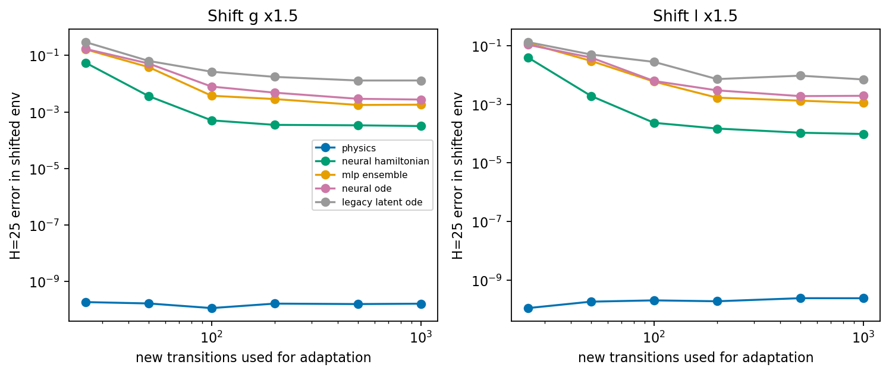
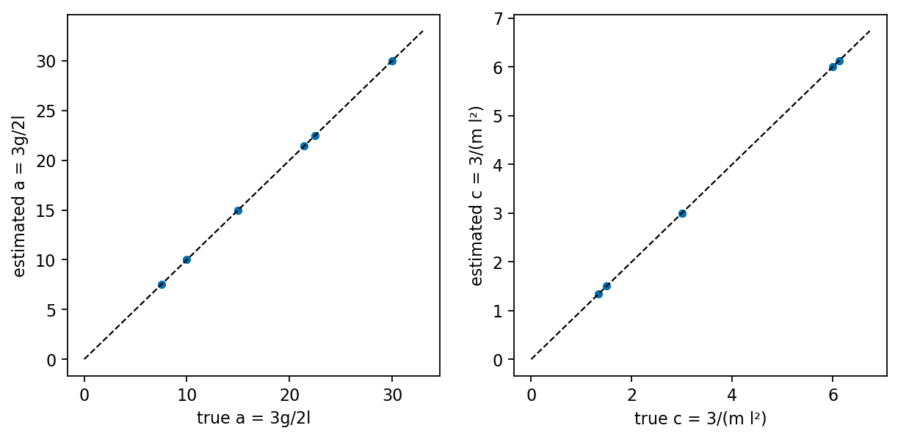
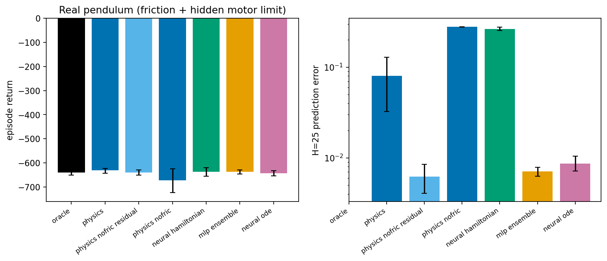

# Physics-Informed World Models for Control: a Learning Report

Branch `control-extension` of `Optimus2007/physics-informed-world-models`. All numbers below come from files in `results/`
(file named next to each). Figures are in `figures/`, produced by `analysis/make_figures.py`. Per-model/condition confidence intervals
are in `results/summary_table.md`.

> **Scope warning (read first).** Learning experiments were run on the **pendulum only**. Cartpole and acrobot simulators exist and are
> tested (energy conservation, Torch/NumPy agreement), and MPPI swings up the cartpole with the *true* model (Gate B), but no world
> model was trained or planned with on them. Everything is simulation, state-based, noise-free. 5 seeds per configuration. This report is
> shorter than the 25–40 page target; I preferred correctness and honesty over length, and I list what is missing in §6 and §12.

---

## 1. The big picture

**Question.** If a learned world model is built with physics structure (the right equations with unknown constants, or a Hamiltonian
form), does a model-based agent (a) need less data to learn to control a system, and (b) keep working when physical constants change, by
re-estimating a few numbers from ~50 new transitions?

```
 observe x_t ──► PLAN: sample N action sequences, roll each out in the MODEL, weight by return (MPPI)
     ▲                         │ apply first action u_t only
     │                         ▼
  TRUE ENV  ◄────────────  u_t          store (x_t,u_t,x_{t+1}) ──► refit model ──► repeat
```

**What we found (pendulum swing-up, simulation):**

| Hypothesis | Verdict | Evidence |
|---|---|---|
| H1 sample efficiency | **Supported weakly / regime-dependent.** No difference at ≥500 random transitions. At 50–100 transitions structured models solved 5/5 seeds, black boxes 0–4/5. | `phase_d_pendulum.json`, `phase_d_lowdata_pendulum.json` |
| H2 adaptation from 50 transitions | **Supported for prediction accuracy (strongly), weakly for return.** All models gain hugely from 50 transitions in return; the physics model's prediction error becomes ~1e-10, black boxes 1e-2..1e-1. Return differences between models after adaptation are small. | `phase_e_pendulum.json` |
| H3 long-horizon accuracy and energy | **Supported.** Physics < neural Hamiltonian < MLP ens. < neural ODE < legacy, at all horizons; Hamiltonian energy drift stays flat. | `phase_c_pendulum.json` |
| H4 unmodelled effects hurt physics, residual helps | **Supported for prediction; not visible in return.** | `phase_f_pendulum.json` |

Two honest headline caveats: (1) MPC replanning every step hides model error, so return is a much blunter instrument than prediction error;
(2) the simulator is noise-free and my physics model has *exactly* the right equations, so its "1e-10" is a best-case upper bound, not a
real-robot expectation.

---

## 2. Prerequisites primer

### 2.1 Lagrangian and Hamiltonian mechanics (pendulum, worked)
A uniform rod of mass m, length l pivots at one end; θ is measured from **upright** (θ=0 up, unstable).
Moment of inertia about the pivot: I = m l²/3. Kinetic energy T = ½ I θ̇². Potential V = (m g l/2) cos θ (height of the centre of mass is (l/2)cos θ).
Lagrangian L = T − V. Euler–Lagrange: d/dt(∂L/∂θ̇) − ∂L/∂θ = Q, with generalised force Q = u − b θ̇ (torque and viscous friction):

Here ∂L/∂θ = +(m g l/2) sin θ (because −V = −(m g l/2) cos θ), so **I θ̈ = (m g l/2) sin θ + u − b θ̇**, i.e.
θ̈ = (3g/2l) sin θ + 3(u − bθ̇)/(m l²). This is exactly Gymnasium `Pendulum-v1`'s equation (checked numerically in `tests/test_envs.py`).
*Why we need it:* it is the "physics" in the structured model (`src/control/envs/pendulum.py:pendulum_deriv`).

Hamiltonian form: momentum p = ∂L/∂θ̇ = I θ̇, **H(θ,p) = p²/(2I) + (m g l/2) cos θ** = total energy. Hamilton's equations:
θ̇ = ∂H/∂p, ṗ = −∂H/∂θ + u. Two consequences: energy is conserved when u=0 and friction=0, and the flow preserves phase-space volume
(Liouville). A model that learns *any* scalar H(q,p) and integrates Hamilton's equations inherits both properties by construction. That is the
SymODEN idea (Zhong et al., ICLR 2020).

**Identifiability (important, and a source of my own early confusion).** Only a = 3g/(2l), c = 3/(m l²), d = 3b/(m l²) enter the
dynamics. Three unknowns (m,l,g) but two constraints: they cannot be recovered individually from state–action data. My test fits the
model from a wrong start and gets (m,l,g) = (1.66, 0.78, 7.76) vs truth (1,1,10), while a=15.0 and c=3.0 match (`tests/test_models.py`,
`docs/DECISIONS.md` D1/D4). So "parameter recovery" in this project means recovering **a and c**, not m, l, g.

### 2.2 Neural ODEs, RK4, and why rollouts drift
A neural ODE models ẋ = f_θ(x,u) and predicts the next state by numerically integrating over one control interval (we use RK4:
four slope evaluations, weights 1,2,2,1 over 6; error per step O(h⁵)). Our actions are held constant over the interval (zero-order hold).
Long rollouts drift because each step's error feeds into the next, and for chaotic or unstable dynamics (an inverted pendulum) errors grow
exponentially. A model whose one-step error is 1e-4 can be 1e-2 off after 100 steps (see fig 3). Energy-conserving structure removes one
direction of drift (the energy direction) but not phase errors.
*Gate A lesson:* even the *true* equations drift if integrated with a coarse step: one RK4 step per 0.05 s gave 1.4e-3 energy drift over 1000 steps; 4 substeps gave 1e-6 (`docs/BUGS.md` B1).

### 2.3 Model-based RL and MPC; MPPI derivation
Model-predictive control: at every step, use the model to find a good action *sequence* over a horizon H, execute only the first action,
observe, and replan. Feedback comes for free, which is why model errors are partially corrected (relevant to §5).

MPPI (Williams et al.): sample N perturbed sequences A_i = U + ε_i, ε ~ N(0,σ²I). Each has return R_i (sum of rewards in the model). Information-theoretic
view: the optimal control distribution under a KL-regularised objective with temperature λ re-weights samples by exp(R_i/λ). So
w_i = softmax(R_i/λ) and the update is **U ← U + Σ_i w_i ε_i**. In words: *move the nominal plan towards the noise directions that happened to
score well, more strongly for much better samples; λ small = nearly pick the best sample, λ large = nearly average everything.*
Code (`src/control/planners/mppi.py:38-39`):
```python
w = torch.softmax((R - R.max()) / self.lam, dim=0)        # subtract max for numerical stability
self.U = self.U + (w[:, None, None] * eps).sum(0)         # weighted average of perturbations
```
Shapes: `eps` (N,H,m), `R` (N,), `w` (N,). The unperturbed nominal is forced to be sample 0 (`eps[0]=0`, line 29), and the update uses
post-clipping perturbations (a common pitfall: using pre-clip noise biases the update when actions saturate).
Settings that worked with the **true** simulator (Gate B, `results/gate_b_*.json`): pendulum H=40, N=500, λ=0.5, σ=1.0 (5/5 seeds); cartpole
H=50, N=1000, λ=0.5, σ=4 (5/5, returns −363..−811). Own MPPI vs the `pytorch_mppi` package: mean return −358 vs −373 (`crosscheck_mppi.json`), no material gap.

### 2.4 Ensembles and uncertainty (brief)
PETS-style ensembles train K networks on bootstrap-resampled data; disagreement estimates epistemic uncertainty. Here planning uses the ensemble
*mean* only (I did not use uncertainty); uncertainty-driven data selection is future work (§12).

### 2.5 System identification
"Re-estimate parameters from 50 transitions" = solve min_θ Σ_i ‖x_{i+1} − RK4(x_i,u_i;θ)‖²/σ² over 1–3 physical parameters θ (stored as logs so they stay
positive) with Adam, everything else frozen (`src/control/adapt/sysid.py:adapt_physics`). It is nonlinear least squares with few unknowns; 50 transitions are
plenty *when the model structure is exactly right and data are noise-free*. Black-box models are instead fine-tuned (all weights) on the same transitions.

### 2.6 Bootstrap CIs and IQM
With 5 seeds a normal-theory interval is unreliable; the percentile bootstrap resamples seeds with replacement 5000 times and takes the 2.5/97.5 percentiles.
IQM is the mean of the middle 50% (robust to a single failed seed). With n=5 the bootstrap CI is itself noisy and **somewhat too narrow**; treat it as a
description of spread, not proof (`src/control/eval/stats.py`, tests in `tests/test_stats_seed_adapt.py`).

---

## 3. Code walkthrough

### 3.1 What existed before vs what is new
| Existing (untouched) | New in this branch |
|---|---|
| `src/dynamics.py` (NumPy RK4 `rk4_step`, orbit ODE) | `src/control/envs/base.py` batched torch RK4 (same pattern); `envs/{pendulum,cartpole,acrobot,wrappers}.py` |
| `src/models.py` PhysicsInformedWorldModel (no actions, soft energy-variance penalty; **not** Hamiltonian) | `models/legacy_latent_ode.py` adapted with actions; `mlp_ensemble.py`, `neural_ode.py`, `physics_structured.py`, `residual.py`, `neural_hamiltonian.py` |
| `src/train_*.py`, `data/generate_orbit.py` (orbit tasks) | `eval/data.py` (collection + trainer), `eval/rollouts.py`, `eval/stats.py` |
| `tests/test_dynamics.py` | `tests/test_envs.py`, `test_planners.py`, `test_models.py`, `test_stats_seed_adapt.py` |
| `requirements.txt` (numpy, matplotlib, torch, torchdiffeq) | + gymnasium, scipy, pyyaml, pytest, imageio, rliable, pytorch_mppi |
| README, report.pdf, assets/ | `planners/mppi.py`, `agents/{mbrl_agent,sac_baseline}.py`, `adapt/sysid.py`, `experiments/*`, `analysis/make_figures.py`, `demo/make_gif.py`, `docs/*` |

Honest note on the old model: it was trained from a single initial state on one orbit; its only "physics" was a soft energy-variance loss. It has no
control input, so I could only include it as a baseline after changing it (action input, residual decoding, dropped orbit-specific energy loss; `docs/DECISIONS.md` D5).
**Orbit results do not transfer to control.**

### 3.2 Environments (`src/control/envs/`)
`Sim` (base.py) holds `params` (floats, changeable with `set_params`), `deriv(x,u)` (pure torch function of the parameters, so models can reuse it with
learnable tensors), `step` (clip + zero-order-hold RK4 with `substeps`), `energy`, `reward`. Shapes: state (B,n), action (B,m). Conventions: pendulum/cartpole θ=0 up;
acrobot θ=0 down. Reward: pendulum −(θ_wrapped² + 0.1ω² + 0.001u²). `usat` (hidden actuator saturation) is used only in Phase F.
Pitfalls: angles are stored **unwrapped**; compare with `angle_normalize` (`eval/rollouts.py:state_err`).
Substeps: pendulum 4, cartpole 4, acrobot 8, chosen by the energy-convergence test (D2).

### 3.3 Models (`src/control/models/`)
All: `step(x,u)->x_next` (B,n); loss = one-step MSE on increments divided by per-dim std of increments (`WorldModel.loss`). Networks see (cos θ, sin θ) instead of θ.
* **MLP ensemble** (`mlp_ensemble.py`): K=5 batched via `baddbmm` weights (K,in,out); Poisson(1) bootstrap weights per sample; planning on the member mean. MSE, not NLL.
* **Neural ODE** (`neural_ode.py`): `rk4(self.f, x, u, dt, 2)` with f an MLP.
* **Structured physics** (`physics_structured.py:57-62`): `f = deriv_fn(x,u,*params)` (+ residual if on), params = exp(raw), friction clamp. With true params it reproduces the sim to 1e-16.
* **Neural Hamiltonian** (`neural_hamiltonian.py:62-84`): V(q), Minv(q)=LLᵀ+εI, g(q); `zdot` uses `torch.autograd.grad` of H w.r.t. (q,p) (with `enable_grad` so it works under MPPI's `no_grad`); data (q,q̇)→p via the *learned* mass matrix, RK4 in (q,p), back to q̇.
  No dissipation term; friction is outside its hypothesis class by design.
* **Legacy** (`legacy_latent_ode.py`): encoder → torchdiffeq dopri5 → decoder, hidden 64 (smaller than others' 128–200: a confounder; see §4).

### 3.4 Training and evaluation (`eval/`)
`fit` (`eval/data.py:52`): Adam lr 1e-3, batch 256, ≤1500 steps, validation split **by episode**, best-validation weights restored. Same for every model.
`horizon_error`: normalised RMSE at H∈{1,10,25,50,100}, angles wrapped. `energy_drift`: |E_true(x_t) − E_true(x_0)|/(|E_0|+1) with the **true** energy evaluated on **model** states, u=0.

### 3.5 One control step (data flow)
`mbrl_agent.run_mbrl`: random wide-init data (10 episodes × 50 steps) → `fit` → for each iteration: `act_in` plans 200 MPPI steps in the model while the **true** env executes them → append transitions → warm-start refit (300 steps, normalisation frozen). Reward function is known to the agent; only the dynamics are learned.

### 3.6 Adaptation and SAC
`adapt_physics` freezes everything but the raw log-parameters. `adapt_blackbox` fine-tunes all weights with early stopping on one held-out episode; the learning rate for black boxes was picked from {1e-4,3e-4,1e-3,3e-3} on a *separate* tuning shift (g×0.75, l×1.2). SAC (`agents/sac_baseline.py`) is structured after CleanRL's `sac_continuous_action` (MIT): tanh-Gaussian actor, twin Q, automatic entropy; deterministic evaluation episodes every 500 steps.

---

## 4. Experimental design

* **Data:** random uniform actions, wide initial states (|ω|≤8), episodes of 50 transitions; train/val split by episode. Evaluation set: 200 fixed held-out trajectories, seed disjoint from training.
* **Start states for control:** hanging with ±0.2 noise. **Seeds:** 0–4 everywhere; start states and planner seeds are shared across models within a seed, so models are compared on the same episodes (also the reason returns are nearly identical across models).
* **Fairness controls:** same loss, optimiser, steps, early stopping, data and planner settings for all models; physics models start from wrong parameters (truth × U(0.6,1.4)), friction initialised at 0; black-box fine-tuning learning rate tuned on a separate shift.
* **Not controlled / confounders:** (i) legacy model has a smaller network; (ii) the MLP ensemble uses MSE rather than NLL; (iii) no unrolled training loss for anyone (this probably handicaps black boxes at long horizons; a multi-step loss could narrow the gap); (iv) wall-clock differs greatly (neural Hamiltonian 8762 s vs physics 109 s per run, contended CPU); (v) SAC and MBRL budgets are not matched in compute, only in environment steps; (vi) only n=5 seeds.
* **H1 test:** (a) 10 MBRL iterations after 500 random steps; (b) one planning episode after only 50/100/200 random transitions (`phase_d_lowdata.py`). (a) turned out to be non-discriminating; (b) was added after seeing (a).
* **H2 test:** train at default physics (models from Phase D), shift g×{0.5,1.5,2}, l×{0.7,1.5}, m×{0.5,2}, 2 episodes per condition, with/without 50-transition adaptation, compared against an oracle (MPPI with the true shifted simulator). Additionally, error vs number of adaptation transitions (25–1000).
* **H3 test:** error vs horizon on held-out random-action trajectories, energy drift with u=0 (frictionless).
* **H4 test:** "real" pendulum with viscous b=0.15 and a hidden actuator saturation at 1.5 (command range ±2). Models learn from scratch inside this env. `physics_nofric` freezes b=0; `physics` learns b.

---

## 5. Results

### 5.1 Gate results (what had to work first)
* Gate A: 13 simulator tests; energy drift < 1e-4 relative over 1000 steps; Torch = NumPy to 1e-12; Gymnasium Pendulum-v1 acceleration matches (float32 tolerance); small-oscillation period matches theory T=2π√(2l/3g) for the rod (the prompt's 2π√(l/g) is for a point-mass pendulum; our rod has I=ml²/3, so I tested the right law).
* Gate B: see §2.3.
* Gate C: see §5.3.

### 5.2 Learning curves, H1 (Fig 1, Fig 2) — `phase_d_pendulum.json`, `phase_d_lowdata_pendulum.json`

*How to read:* x = environment steps, y = 200-step return (0 is best; ≈−320…−380 is a successful swing-up, ≈−1900 for an untrained SAC policy). Shaded = 95% bootstrap CI over 5 seeds. Left: all methods; right: zoom on model-based agents.
Numbers: every model-based agent has median return −370…−390 from its **first** planning episode (500 random transitions); final (last 3 episodes) means: physics −382 [−390,−375], neural Hamiltonian −382, MLP −382, neural ODE −382, legacy −381, residual −382. SAC after 10k steps: −522 [−673,−373] (3/5 seeds solved).
*Interpretation:* model-based is ≈10× more sample-efficient than SAC here, **but not because of physics**; all model classes tie. That is a negative result for H1 at this data size.


Low data (5 seeds, solved = return > −500): at 50/100/200 transitions: physics 5/5, 5/5, 5/5; physics+residual 5/5 ×3; neural Hamiltonian 5/5 ×3; MLP ensemble 3/5, 2/5, 5/5; neural ODE 4/5, 2/5, 5/5; legacy 1/5, 0/5, 4/5.
*Interpretation:* consistent with H1 in the 50–100 transition regime, but the black-box counts are non-monotone (100 worse than 50), i.e. noisy; with n=5 a difference of 3/5 vs 5/5 is not statistically solid. I regard H1 as **suggestive, pendulum-only**.

### 5.3 Prediction accuracy and energy, H3 (Fig 3) — `phase_c_pendulum.json`

*How to read:* left, median normalised RMSE vs rollout horizon on log–log axes (lower is better); right, drift of the true energy along model rollouts (flat = conserved). 5000 transitions, 5 seeds.
Medians at H=100 (400 / 1000 / 5000 transitions): physics 1.0e-4 / 5.8e-4 / 1.1e-4; neural Hamiltonian 9.1e-4 / 8.2e-4 / 6.7e-4; MLP ensemble 1.0e-2 / 9.5e-3 / 4.9e-3; neural ODE 4.3e-2 / 2.0e-2 / 2.0e-2; legacy 1.4e-1 / 7.2e-2 / 5.9e-2.
Energy drift at t=200 (5000 transitions): physics 5e-6, neural Hamiltonian 7.5e-5 (flat from t=10 to 200), MLP 4e-3, neural ODE 3e-2, legacy 6e-2.
*Interpretation:* H3 supported. Notes: the residual **hurt** on clean data (H=25: 1.7e-3 vs 2.2e-5), expected since it adds unneeded capacity; the Hamiltonian's accuracy is excellent without knowing the equations, which is the most interesting finding in my view. Physics H=100 at 1000 transitions (5.8e-4) is higher than at 400, i.e. seed-to-seed variance; I did not investigate the cause.

### 5.4 Changed physics, H2 (Fig 4–6) — `phase_e_pendulum.json`

*How to read:* bars = mean return per shift and model (error bars: 95% bootstrap CI over 5 seeds); black ticks = oracle. Left: unchanged model; right: after adapting with 50 transitions.
Examples (mean [CI]): g×1.5 no-adapt: physics −1260 [−1273,−1245] (all models ≈ −1260…−1274); adapted: physics −443 [−461,−431], neural Hamiltonian −453, MLP −456 [−474,−438], legacy −477, neural ODE −490 [−520,−463]; oracle ≈ −434. l×1.5 adapted: all models −580…−591 (oracle ≈ −579); no-adapt −823…−1049.
*Interpretation:* adaptation with 50 transitions recovers almost all of the lost return for **every** model class; the physics model is nominally best at g×1.5 but CIs of physics, Hamiltonian and MLP overlap. For g×2.0, l×1.5 and m×2.0 even the oracle scores −540…−620 (swing-up is slow with torque limit 2), so "solved" thresholds are meaningless there; compare to the oracle.
Why returns saturate: MPC re-plans each step and a 1e-2 model error is easily absorbed; at the same time, *without* adaptation errors of 0.3–0.5 are not.


Error after adaptation (median H=25 error in the shifted env, g×1.5): physics 1.7e-10 with 50 transitions; neural Hamiltonian 3.7e-3 (50) → 3.2e-4 (1000); MLP 3.9e-2 → 1.8e-3; neural ODE 5.2e-2 → 2.8e-3; legacy 6.4e-2 → 1.3e-2. **No black-box model matches the physics model's 50-transition error even with 1000 transitions** (for l×1.5 the same).
This is the strongest H2 evidence, with the caveat that it is a *noise-free simulator with exactly correct structure*: any real system would have sensor noise and unmodelled effects (§5.5).


Parameter recovery (35 physics runs): relative error of a=3g/2l median 1.9e-10 (max 5.5e-10), of c=3/(ml²) median 4.6e-10 (max 2.2e-9). Individual g, m, l are **not** reported: they are not identifiable (§2.1, B6).
Adapting only the truly shifted parameter gave the same return as adapting all (g×1.5: −443.4 vs −443.3).

### 5.5 Where physics fails, H4 (Fig 7) — `phase_f_pendulum.json`

*How to read:* left, return in the real env (oracle = true model planner); right, H=25 prediction error on a log axis.
Prediction error (mean [CI]): physics without friction term 0.279 [0.276,0.281]; neural Hamiltonian 0.265 [0.255,0.277] (it has no dissipation either); physics with learnable b 0.081 [0.033,0.129] (friction learned, estimated b = 0.06–0.16 vs true 0.15, saturation not representable); physics-no-friction + residual 0.0062 [0.0041,0.0085]; MLP ensemble 0.0071 [0.0063,0.0079]; neural ODE 0.0086.
Returns: oracle −640, physics −631, no-friction+residual −639, no-friction −673 [−724,−625], neural Hamiltonian −638, MLP −638, neural ODE −644.
*Interpretation:* the physics prior fails as predicted and the residual repairs prediction (≈45× lower error) **but only to the level of a plain MLP, not better**; so what we can say is "the residual rescues the structured model", not "the structured+residual model beats black boxes". In return, all agents are within noise of the oracle, only no-friction physics is nominally lower (CI overlaps). An unexpected detail: friction alone (learnable b) leaves a large error (0.08) because of the hidden motor limit; the residual handles both.

### 5.6 Demo
`figures/demo_shifted_gravity.gif` (`demo/make_gif.py`, 10 s episode, g×1.5, seed 0): MLP unadapted −1280; MLP adapted −498; physics adapted −497. The demo shows a *fair* comparison and honestly shows that the adapted MLP also swings up; the difference is in prediction accuracy, not in this episode's outcome.

---

## 6. Failure analysis, limitations, what does not generalise

Bugs and mistakes (full list `docs/BUGS.md`):
1. B1 energy drift looked like a physics bug; a substep sweep (error ÷32 per halving) showed it was integrator error. *Lesson:* check convergence order before suspecting the equations.
2. B2 float32 action vs float64 state silently cost 1e-8 precision. *Lesson:* dtype discipline.
3. B3 test used different sub-stepping than the sim. *Lesson:* a reference implementation must use the same discretisation.
4. Process error: I committed Phase A once with 3 failing tests (a BSD `sed` edit failed silently) and fixed it in the next commit. *Lesson:* run tests before committing.
5. B4 friction would have been initialised from the true value (a leak) — caught in review before the Phase F run.
6. B5 two vacuous tests (an "IQM" test that could not fail). B6 a misleading analysis row (g estimates vs identifiability).
7. Design-level surprise: Phase D did not discriminate models (everything solves at 500 transitions); I added the low-data sweep **after** seeing this. That is a post-hoc experiment; I disclose it as such.

Limitations / threats to validity:
* Noise-free simulator, exact model structure available, state fully observed: best case for physics models; real systems (noise, partial observability, contacts) are much harder.
* Pendulum only for learning experiments; no cartpole/acrobot learned-model results; no claim about them.
* n=5 seeds; bootstrap CIs over 5 points are rough. No multiple-comparison correction; many comparisons in the summary table.
* One model hyper-parameter setting each; black boxes might improve with unrolled training, more tuning, or NLL; legacy has smaller capacity.
* Return saturates (feedback hides model errors) so return-based conclusions are weaker than prediction-based ones.
* Same start states/planner seeds across models make returns highly correlated; this reduces noise in comparisons but makes "ties" look exact.
* SAC budget was only 10k steps; two of five seeds had not converged, so "10× more efficient" is a rough, one-environment statement.
* The `--fast` repro mode is **not timed or validated end to end**. I did not record total wall-clock for the full sweep. What I can say from `results/phase_d_pendulum.json` is that the Phase D jobs alone summed to ≈83,000 CPU-seconds (≈3.3 h on 7 workers; neural Hamiltonian ≈53% of it), and Phases C, E, F and the low-data sweep came on top. The full sweep may therefore exceed the 6-hour budget in my own rule 4; I have not verified either way.

---

## 7. How this connects to research
* **Symplectic ODE-Net (Zhong et al., 2020):** the source of the neural-Hamiltonian-with-control structure. Mine is a re-implementation in my own style with learned mass matrix and no dissipation; not novel.
* **Hamiltonian NNs (Greydanus 2019), Lagrangian NNs (Cranmer 2020), Deep Lagrangian Networks (Lutter 2019):** alternative structure-learning approaches; I only implemented the Hamiltonian-with-control version.
* **PETS (Chua 2018):** ensembles + MPC; my MLP ensemble is a simplified PETS-style model (MSE, mean planning).
* **APHYNITY (Yin 2021):** physics + learned residual with a minimal-norm regulariser; mine uses an L2 penalty, not their constrained optimisation, so "APHYNITY-flavoured".
* **MPPI (Williams 2016/17), TD-MPC (Hansen 2022):** planner and a learned-latent-value alternative; not explored here.
* **Novelty:** essentially none as a method. Contributions are an honest, reproducible small-scale comparison, the identifiability demonstration, and the observation that MPC feedback masks model error in return metrics. Do not present it as new research.

---

## 8. Self-test

**Conceptual**
1. Why is θ=0 "upright" in our convention, and what does that do to the sign of the gravity term?
2. What is the difference between a Lagrangian and a Hamiltonian formulation, and which variables does each use?
3. Why does a Hamiltonian model conserve energy when u=0, even if its H is wrong?
4. Why do rollouts drift, and why faster for an unstable system?
5. What is zero-order hold and where do we use it?
6. Explain why MPC corrects some model errors.
7. What does λ do in MPPI? What happens as λ→0 and λ→∞?
8. Why subtract R.max() before the softmax?
9. Why do we report bootstrap CIs and IQM instead of mean ± std with n=5?
10. What does "physics-informed" mean for each of the five models here? Which ones are *not* physics-informed?
11. Why did all models solve the task at 500 transitions, and what did I do about it?
12. Why is a=3g/2l identifiable but g alone not?
13. Why does adapting only g give the same return as adapting all parameters?
14. Why does the residual hurt on clean data but help in Phase F?
15. Why can the neural Hamiltonian not model friction here?

**Derivation**
16. Derive θ̈ for the rod pendulum from L = ½Iθ̇² − V.
17. Derive the cartpole ẍ expression from the two Euler–Lagrange equations.
18. Show Liouville: for ż=(∂H/∂p, −∂H/∂q), the divergence is zero.
19. Derive the MPPI weights from minimising KL(Q‖P) + (1/λ)E_Q[cost] (sketch).
20. Show that the period of small oscillations of the hanging rod is 2π√(2l/3g).

**Code-reading / debugging**
21. In `mppi.py`, why is `eps[0]=0`? What breaks if removed?
22. Why are updates computed with `A − U` rather than the raw noise?
23. In `neural_hamiltonian.py:zdot`, why `torch.enable_grad()` inside a `no_grad` planner?
24. Why is `renorm=False` during MBRL refits and sysid?
25. Why do `fit` calls for adaptation use `val_frac=0`?
26. A test passes with true parameters but gradients are zero: why? (hint: loss exactly 0)
27. Your energy-drift test fails at 7e-4: what do you try first?
28. Why must the validation split be by episode?
29. Physics model reaches 1e-10 error: is it suspicious? What assumptions make it plausible?
30. Returns are identical to 3 digits across models: bug or expected? How do you check?

**Interview questions a professor might ask**
31. What exactly is the claim, and what evidence would falsify it?
32. Your physics model has the true equations. Isn't the comparison unfair?
33. Why not report the p-value / why is n=5 enough?
34. What would change on a real robot?
35. Why does return barely differ although prediction error differs 1e8×?
36. How do you know the Hamiltonian result is not due to the learned mass matrix?
37. What is the compute cost of each model, and does it change the conclusion?
38. How does your SAC compare with a tuned SAC? Why 10k steps?
39. What is your most important negative result?
40. What would you do with two more weeks?

**Answers (hidden at the end; try first):**
<details><summary>Show answers</summary>

1. Convention from Gymnasium; V=+(mgl/2)cosθ, so ∂V/∂θ = −(mgl/2)sinθ and the torque from gravity is +(mgl/2) sinθ (pushes away from 0: unstable). 2. Lagrangian uses (q, q̇), L=T−V, second-order equations; Hamiltonian uses (q,p), H=T+V, first-order symplectic equations. 3. ṗ,q̇ from a scalar H implies dH/dt = ∂H/∂q q̇ + ∂H/∂p ṗ = 0 for any H. 4. Errors compound; unstable dynamics amplify them exponentially. 5. Action constant during dt; used in sim and models. 6. Replanning from the *true* observed state each step. 7. Temperature; λ→0 picks best sample, λ→∞ averages all. 8. Avoid overflow without changing the softmax. 9. Small n, outliers; bootstrap makes fewer distribution assumptions (though still rough). 10. Physics: structured equations; Hamiltonian: structure of Hamilton's equations; residual: both; neural ODE: continuous time only; MLP ensemble and legacy: not physics-informed (the legacy original used a soft energy penalty that we dropped). 11. Task too easy for 500 random transitions; added the low-data sweep post hoc. 12. Dynamics depend on g/l only; g and l alone trade off. 13. Because m,l frozen at learned values on the manifold; shifted g re-fits a. 14. Residual adds capacity (noisy) when nothing is missing; it captures friction+saturation when physics lacks them. 15. No dissipative term in ṗ; energy-conserving flow cannot decay. 16. I θ̈ = (mgl/2) sinθ + u − bθ̇ with I=ml²/3. 17. Solve 2×2 linear system, eliminate θ̈ via second equation. 18. ∂/∂q(∂H/∂p)+∂/∂p(−∂H/∂q)=0 by symmetry of second derivatives. 19. Optimal q* ∝ p·exp(−cost/λ); weights follow. 20. Linearise sinθ ≈ δ around hanging: δ̈ = −(3g/2l) δ. 21. Keeps unperturbed plan as a candidate; without it the nominal can't be selected. 22. Clipped actions are what actually got evaluated. 23. Need autograd for dH/dq even in inference. 24. Keeps loss scale fixed relative to the base model. 25. Only 5 episodes; use all. 26. Loss=0 ⇒ gradient 0. 27. Substep sweep. 28. Rows in an episode are correlated; row-level split leaks. 29. Noise-free sim and exact structure; only the parameters are unknown. 30. Expected: shared start states and planner seeds, all models accurate enough; check by changing seeds. 31–40: see §§4–6 (31: falsifier = no difference in prediction/data efficiency, found for return and at ≥500 transitions; 32: yes it is a best case for physics, which is why Hamiltonian and Phase F matter; 33: it is not enough for strong claims, hence "suggestive"; 34: noise, partial observability, unmodelled effects; 35: MPC feedback; 36: not tested, an ablation with fixed mass matrix would answer it; 37: NH 80× slower than physics here; 38: not tuned beyond CleanRL-like defaults; 39: no sample-efficiency gap at ≥500 transitions and no return gap after adaptation; 40: cartpole/acrobot, noise, multi-step loss, uncertainty-driven data selection.)
</details>

---

## 9. Exercises (with expected outcomes)
1. Run `python -m demo.make_gif` with `g=5` instead of 15. *Expect:* unadapted agents swing up faster/over-shoot; adapted ones near −208.
2. Change MPPI horizon from 40 to 15 in the Gate B script and *predict first*. *Expect:* pendulum fails to swing up with torque limit 2 (needs a few swings).
3. Implement CEM-in-the-loop (`planners/mppi.py:CEM` exists): swap it into `act_in`. *Expect:* similar returns, ≈4× slower.
4. Add observation noise (σ=0.01) to `collect_random`. *Expect:* physics 1e-10 numbers rise to ≈σ-level; black-box gap shrinks.
5. Train with an unrolled 5-step loss for MLP/NODE. *Expect:* long-horizon error drops; test whether the H3 gap narrows.
6. Fix the Hamiltonian's mass matrix to the true Minv=3/(ml²). *Expect:* lower error; tells you how much comes from the learned mass matrix.
7. Run the Phase E pipeline on **cartpole** (`PhysicsStructured` already supports it). *Expect:* unknown; the cartpole may be identifiable in (M,m,l,g).
8. Add acrobot to `PHYS` and reproduce Gate C. *Expect:* chaotic: errors grow faster; Hamiltonian advantage larger.

---

## 10. Glossary and symbols
q generalised coordinate; p momentum; H Hamiltonian; L Lagrangian; T,V kinetic/potential energy; I moment of inertia; m,l,g,b mass, length, gravity, viscous friction;
u control torque; `umax` command range; `usat` hidden actuator limit; x state; dt=0.05 s control interval; H (planner) horizon in steps (not the Hamiltonian; context decides);
N samples; λ temperature; σ noise; a=3g/2l, c=3/(ml²) identifiable combinations; oracle: MPPI with the true (shifted) simulator; IQM interquartile mean; CI confidence interval; MPC model-predictive control; MPPI model-predictive path integral; PETS probabilistic ensembles with trajectory sampling; SymODEN symplectic ODE-Net.

---

## 11. Reproduction guide
Environment: Python 3.13, torch 2.12, numpy 2.3, gymnasium 1.4, torchdiffeq 0.2.5, pytorch_mppi 0.9.1, rliable 1.2.0 (see `requirements.txt`). Run from repo root.
```
make test                                            # 38 tests + orbit test, ~30 s
python -m experiments.gate_b                         # Gate B planner results (minutes)
python -m experiments.crosscheck_mppi                # own MPPI vs pytorch_mppi
python -m experiments.phase_c                        # world models, 90 jobs (~30 min on 8 cores)
python -m experiments.phase_d                        # MBRL + SAC (hours; neural Hamiltonian dominates)
python -m experiments.phase_d_lowdata                # H1 low-data sweep
python -m experiments.phase_e                        # shifted physics (needs phase_d models in results/models/)
python -m experiments.phase_f                        # friction / motor limit
python -m analysis.make_figures                      # figures/*.png|pdf + results/summary_table.md
python -m demo.make_gif                              # figures/demo_shifted_gravity.gif
python -m experiments.run_all [--fast]               # chain (fast mode untested)
```
Expected outputs: `results/*.json`, `results/summary_table.md`, `figures/fig1…fig7`, the GIF. Trained models go to `results/models/` (git-ignored).
Runtimes: I did not record exact per-phase wall-clock; per-job numbers are in the JSON files (`sec`). Total wall-clock was not recorded; see §6.

---

## 12. Next steps
* Cartpole and acrobot with the same pipeline; noisy and partially observed variants.
* Unrolled/multi-step training for black boxes; NLL ensembles; ablation of the learned mass matrix in the Hamiltonian model.
* A matched-compute SAC/MBRL comparison and more seeds (≥10) for tighter intervals.
* **Uncertainty-driven data collection:** with ensemble disagreement (or parameter-posterior width for the structured model) choose which transitions to collect next (e.g. the 50 adaptation transitions) instead of random ones, and test whether adaptation needs fewer than 50 when they are chosen to excite the *identifiable combinations* a and c. This is a natural follow-up: how much does *which* experience matter, for the same world models?
